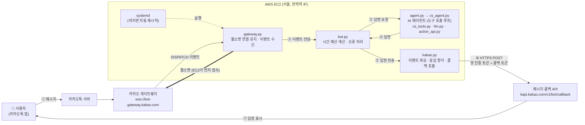
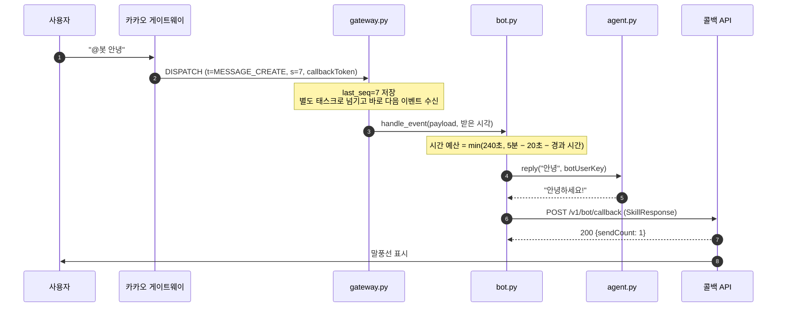
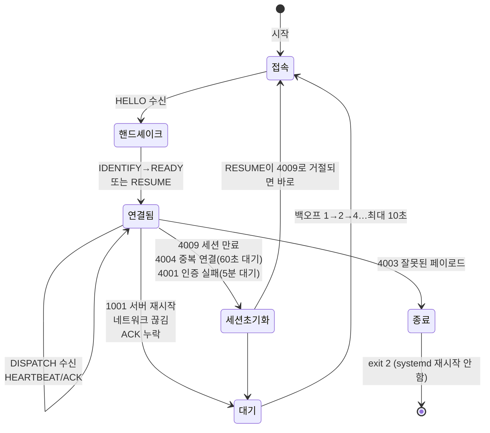
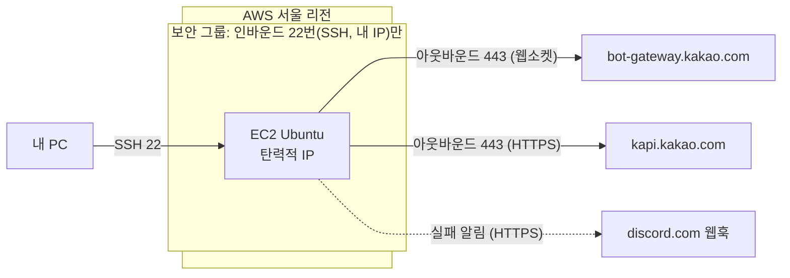

# 전체 아키텍처

AI_TOP_100 예선용 카카오톡 AI 봇의 구조를 설명한다. 처음 보는 용어는 [용어집](glossary.md)에서 찾을 수 있다. 용어 옆의 링크를 누르면 해당 설명으로 이동한다.

## 한눈에 보기



> 이 흐름도는 [Mermaid](glossary.md#mermaid) 문법으로 작성했다. GitHub나 VS Code 마크다운 미리보기(Mermaid 확장 설치)에서 그림으로 보인다. 텍스트로만 보이는 환경이면 아래 요약을 본다.

```
사용자 ─① 메시지─▶ 카카오톡 서버 ─▶ 게이트웨이 ◀══웹소켓══ EC2(gateway.py)
                                                 │ ② DISPATCH 이벤트
                                                 ▼
                                   bot.py ─③▶ agent.py ─④▶ bot.py
                                                 │ ⑤
                                                 ▼
사용자 ◀─⑦ 답장─ 카카오톡 서버 ◀─⑥ 콜백 API─ kakao.py
```

**핵심은 두 가지다.**
1. **받는 길과 보내는 길이 다르다.** 메시지는 [웹소켓](glossary.md#웹소켓) 연결로 받고, 답장은 별도의 HTTPS 요청([메시지 콜백 API](glossary.md#메시지-콜백-api))으로 보낸다.
2. **연결은 EC2가 먼저 건다.** 그래서 EC2에 도메인, [HTTPS 인증서](glossary.md#https와-tls-인증서), 열린 인바운드 포트가 필요 없다. 이것이 [웹훅](glossary.md#웹훅) 대신 [게이트웨이](glossary.md#게이트웨이)를 고른 이유다.

## 메시지 한 건의 일생



| 단계 | 시간 제한 | 넘기면 |
|---|---|---|
| 콜백 토큰 사용 | 받은 뒤 **5분** | 토큰이 만료되어 답장할 수 없음 |
| 에이전트 답변 생성 | `min(240초, 남은 시간 − 20초)` | 시간 초과 안내 문구로 답장 |
| 콜백 HTTP 요청 | 연결·읽기 각 10초 | 로그만 남김 (연결 실패면 최대 2회 재시도) |

> 웹훅 방식이었다면 이벤트 수신 후 **1초 안에** 응답해야 하는 제약이 하나 더 있다. 게이트웨이에는 이 제약이 없다.

## 구성 요소

| 파일 | 역할 | 자세히 |
|---|---|---|
| `gateway.py` | 카카오 게이트웨이와 웹소켓 연결을 맺고 유지한다. [HELLO → IDENTIFY → READY](glossary.md#핸드셰이크-hello--identify--ready) 핸드셰이크, [HEARTBEAT](glossary.md#heartbeat와-heartbeat_ack), [재연결](#연결이-끊겼을-때-재연결)을 처리한다. 이벤트는 받는 즉시 별도 [태스크](glossary.md#asyncio와-태스크)로 넘긴다. | [게이트웨이 명세](kakao_bot_api.md#이벤트-수신-방식-둘-중-하나만-사용) |
| `bot.py` | 수신 방식과 무관한 처리를 맡는다. `MESSAGE_CREATE`만 골라 에이전트를 부르고(나머지 이벤트는 종류만 `event ignored`로 기록), 시간 예산을 계산하며, 오류가 나면 안내 문구를 만든다. 에이전트는 게이트웨이 연결과 [분리된 스레드](glossary.md#이벤트-루프-블로킹)에서 실행한다(`AgentRunner`). | |
| `agent.py` | 실제 AI 로직을 담는다. `reply(content, user_key)` 하나만 지키면 내부는 자유롭게 바꿀 수 있다. 문자열을 돌려주면 말풍선 하나로, `kakao.skill_response(...)`를 돌려주면 말풍선 여러 개·카드로 보낸다. 추천 질문은 `kakao.suggestion_card(...)`의 [버튼](glossary.md#skillresponse)으로 보낸다(퀵리플라이는 채널채팅에서 보이지 않음, 10/28 실측). 사용자의 첫 메시지 답장에는 `with_intro`가 소개 글(`INTRO`)과 추천 질문 카드(`EXAMPLE_QUESTIONS`)를 붙인다. 이미 대화한 계정으로 채팅방에 다시 들어가는 등을 해도 입장 이벤트가 오지 않아(10/28 실측, 처음 들어오는 계정은 확인 안 함) 첫 메시지로 판단하고, 말풍선 3개 제한 안에서 답변을 먼저 지킨다. 인사한 사용자 목록은 메모리에만 있어 재시작하면 다시 인사한다. `user_key`는 보낸 사람의 `botUserKey`로, 동시에 쓰는 여러 사용자의 대화 상태를 나누는 데 쓴다. 상태를 고치는 부분은 사용자별 잠금(`user_lock`, `user_thread_lock`) 안에 둬서, 같은 사용자의 메시지는 순서대로, 다른 사용자끼리는 병렬로 처리한다([경쟁 상태](glossary.md#경쟁-상태와-사용자별-잠금)). `async def`(비동기 SDK)와 `def`(동기 SDK) 둘 다 된다. `health_check`(`llm.health_check`, 모델 목록 한 쪽 조회로 토큰을 쓰지 않음)는 시작할 때와 5분마다 LLM API 상태를 확인한다. `reply`와 같은 방식(`bot.runner.call`)으로 메인 루프 밖에서 실행된다. 메시지 하나는 [LLM 한 번 → Python 결정 → 템플릿 답변](#에이전트-내부-흐름)으로 처리한다. 사용자별 상태(최근 대화 6개, 추가 질문 중인 의도)는 메모리에만 있다. | [에이전트 내부 흐름](#에이전트-내부-흐름) |
| `llm.py` | Anthropic API 호출(`AsyncAnthropic`). 모델(`MODEL`, 기본 `claude-opus-5-5`), `effort`(기본 `low`), 호출당 timeout 30초·재시도 1회, [구조화 출력](glossary.md#구조화-출력)(JSON 스키마)을 정한다. 거절(`refusal`)되면 서버가 다른 모델로 다시 실행하도록 `fallbacks: "default"`를 켠다. 실패는 예외 대신 `Extraction.status`(`rate_limited`, `timeout`, `network`, `api_error`, `format_error`, `refusal`)로 돌려준다. | |
| `cs_agent.py` | 예선 문제(고객 응대) 에이전트. TC ID·인입 계정 파싱, 사용자별 상담 상태(대화 기록은 thinking 블록까지 그대로 다시 보냄), 지식 로드, Claude 도구 호출 루프, 답 정리(말풍선 1개, 480자). 모델은 `AGENT_MODEL`(기본 `claude-sonnet-5-5`), effort는 `AGENT_EFFORT`(기본 `low`). | [에이전트 내부 흐름](#에이전트-내부-흐름) |
| `cs_config.py` | 문제별 설정 읽기(인프라). `data/cs_config.json`·`data/rules.md`(git 제외)가 있으면 그것, 없으면 공개 예시 `cs_config.example.json`·`rules.example.md`. 엔드포인트 표, 주문번호 형식, 보상 쿠폰 목록, 이관 구분·태그, 달력, 정책 수치, 알레르기 품목. | |
| `cs_tools.py` | 액션 API 엔드포인트(`cs_config`의 표)를 Claude 도구로 정의하고, 실행 전에 경로 값 형식·대상 소유(로그인 계정)·쿠폰 코드를 코드로 확인한다. 다른 회원 정보는 결과에서 지운다. | |
| `policy.py` | 주제와 무관한 결정 규칙. LLM이 뽑은 의도·값을 `problem.py`에 정의된 것만 받아들이고([인젝션](glossary.md#프롬프트-인젝션) 방어), 타인·다수 정보 요청은 권한이 확인될 때만 처리하며, 필수 값이 없거나 형식이 틀리면 받은 값을 `problem.precheck`로 먼저 대조한 뒤 되묻는다(10/30 예행연습에서 없는 품목에 날짜부터 되묻는 문제가 나와 추가). LLM 실패별 안내 문구, 시스템 프롬프트 틀(500자, 마크다운 금지, 지어내지 않기, 나이 많은 사용자를 위한 쉬운 말·날짜 표기·하나씩 묻기, 오타·사투리 해석), 마크다운 정리(`clean_reply`)도 여기 있다. | |
| `action_api.py` | 운영진 액션 서버(API) 호출. 대회 규정상 연동이 필수라 10/31 아침에 틀만 만들었다. 주소·키는 `.env`의 `ACTION_API_BASE_URL`·`ACTION_API_KEY`, 인증 헤더는 `headers()`에서 당일 문제 페이지 방식에 맞춘다. `httpx.AsyncClient`(루프별 1개), timeout 10초. 연결 실패(`ConnectError`, `ConnectTimeout`)만 1회 재시도한다. 예약·등록처럼 상태를 바꾸는 요청을 시간 초과 뒤 다시 보내면 두 번 처리될 수 있어서다([재시도와 일회용 토큰](glossary.md#재시도와-일회용-토큰)). 실패는 예외 대신 `Result.ok=False`로 돌려주고, 응답 해석과 답변은 `problem.py`가 Python으로 한다. | |
| `problem.py` | **예선 당일 주로 고치는 파일.** 의도·값 목록과 사용자에게 보일 값 이름(`SLOT_LABELS`), 값 형식, 데이터 적재·검증, 권한 조건, 되묻기 전 대조(`precheck`), 의도별 처리, 답변 문장, `INTRO`·`EXAMPLE_QUESTIONS`. 지금은 골격 시험용 예시(기록 번호 조회)다. 같은 예시가 `tests/example_problem.py`에도 있어, 골격 시험(`tests/test_agent.py`)은 그것을 쓰고 당일 `problem.py`를 바꿔도 깨지지 않는다. 새 문제의 시나리오는 `tests/scenarios.json`에 쓰고 `tests/test_scenarios.py`가 돌린다. | |
| `kakao.py` | 카카오 형식 변환을 맡는다. 이벤트 파싱, [SkillResponse](glossary.md#skillresponse) 생성(`simple_text`, `text_card`, `suggestion_card`, `list_card` 등), 콜백 API 호출을 한다. 말풍선 3개, 글자 1,000자를 넘는 부분과 퀵리플라이는 오류 없이 화면에 보이지 않으므로(실측) 보내기 전에 빼고 경고 로그를 남긴다. 에이전트 답변이 문자열도 올바른 SkillResponse도 아니면 `bot.py`가 오류 안내 문구로 답한다. 카드별 필수 칸은 검사하지 않으므로, 카카오가 카드 답장을 거절하면(400 또는 `sendCount: 0`) `bot.py`가 `kakao.plain_text()`로 글자만 모아 같은 콜백 토큰으로 한 번 더 보낸다(로그 `callback=fallback`). 이미 사용된 토큰(-881)이면 다시 보내지 않는다. 카카오는 필수 칸이 빠진 카드도 `200`으로 받아 보여 주므로(10/28 실측) 이 재전송은 드문 경우의 대비책이고, 답장 모양은 휴대폰 화면으로 확인한다. | [REST API 명세](kakao_bot_api.md#메시지-콜백-api) |
| `config.py` | 시작할 때 프로젝트 폴더의 `.env`를 읽어 환경변수로 넣는다. 이미 설정된 환경변수가 있으면 그 값이 우선한다. 로그를 화면과 `logs/bot.log`에 함께 남기도록 설정한다([로그](glossary.md#로그와-로그-로테이션)). | [환경변수와 .env](glossary.md#환경변수와-env) |
| `main.py` | **예비용** 웹훅 서버(FastAPI)다. 지금은 배포하지 않는다. | [웹훅을 쓰려면](deploy_ec2.md#부록-웹훅-방식으로-바꾸려면) |
| `deploy/ai-top-100.service` | [systemd](glossary.md#systemd) 서비스 정의. 부팅 시 자동 실행하고, 꺼지면 재시작한다. 실패하면 `OnFailure=`로 알림 서비스를 실행한다. | [배포 가이드](deploy_ec2.md) |
| `notify_failure.py`, `deploy/ai-top-100-alert@.service` | 서비스가 실패하면 실패 원인, 현재 상태, 최근 로그(비밀값은 가림)를 [디스코드 웹훅](glossary.md#디스코드-웹훅)으로 보낸다. 자동 재시작되는 실패는 5분에 한 번만, 재시작되지 않는 실패(종료 코드 2)는 매번 알린다. | [실패 알림](deploy_ec2.md#실패-알림-디스코드) |
| `alerts.py` | 프로그램은 살아 있는데 답을 못 하는 상황을 같은 웹훅으로 알린다. 답장이 3번 연속 실패하거나(`bot.py`가 결과를 넘김), 게이트웨이 접속이 5분 넘게 끊기거나(`Gateway.disconnected_since`를 30초마다 확인), `agent.health_check`(토큰을 쓰지 않는 LLM 상태 확인, 5분마다)나 `agent.warm_cache`(프롬프트 캐시 예열, 5분마다 확인해 같은 모델의 마지막 호출이 50분보다 오래됐을 때만 부르는 짧은 실제 호출)가 2번 연속 실패하면 알리고, 복구되면 다시 알린다. LLM 호출이 크레딧 부족으로 거절되면 바로 알린다(10분에 한 번, `cs_agent._create`가 결과를 넘김). 사용액 추정 보고·경고는 `spend.py`가 만든다(호출마다 `usage`로 누적, `logs/spend.json`). 남은 추정액이 줄면 `cs_agent.budget_stage`가 절약 모드(Haiku, 도구 3회)·멈춤(LLM 없이 고정 문구)으로 바꾸고 처음 한 번 알린다. 비동기로 하나씩 순서대로 보내 연결을 막지 않고, 종료할 때는 최대 5초만 기다린다. | [실패 알림](deploy_ec2.md#실패-알림-디스코드) |

의존 방향은 `gateway.py → bot.py → agent.py, kakao.py` 순이다(`agent.py`는 다시 `problem.py → policy.py → llm.py`를 쓰고, `problem.py`의 처리 함수는 `action_api.py`를 부른다). 아래쪽 파일은 위쪽을 모른다. 그래서 수신 방식을 웹훅(`main.py`)으로 바꿔도 `bot.py` 아래는 그대로 쓴다.

## 에이전트 내부 흐름

예선 문제(농수산물 조합 온라인몰 고객 응대)는 `cs_agent.py`가 처리한다. `agent.reply`는 `AGENT_MODE`(기본 `cs`)에 따라 `cs_agent.reply`로 넘기고, `AGENT_MODE=skeleton`이면 아래 "골격" 흐름을 쓴다(골격 시험은 `tests/conftest.py`가 skeleton으로 둔다).

```text
cs_agent.reply(content, user_key)
  └ 사용자별 잠금(agent.user_lock) 안에서
     ├ parse_case: 메시지 앞머리 묶음(case metadata)에서 TC ID, 인입 계정(이름·전화 끝 4자리·회원 ID), 상담 인입 일시를 찾아 기억
     │   (계정은 상담을 시작하는 메시지의 앞머리에서만 받음. 본문 속 자기 주장이나 중간 메시지로는 안 바뀜)
     │   └ 다른 TC ID가 오면 상담(대화 기록·세션)을 새로 시작
     ├ cs_tools.identify_member: 이름으로 회원 검색(search_members_by_name) → 전화 끝 4자리로 회원 특정 (상담당 1회)
     ├ 사진(image: 줄, 카카오 이미지 주소) → 내려받아 이미지 입력, 음성 → "들을 수 없음" 표시
     └ 도구 호출 루프 (Claude, 최대 4회, 전체 50초, 예산 가드: 절약 Haiku 3회 / 멈춤 고정 문구)
         ├ system = [규칙 + 지식(시작 시 1회 로드, 캐시 1시간)] + [상담 정보(회원, 오늘 날짜)]
         ├ tool_use → cs_tools.execute (액션 API 도구, 병렬 실행)
         │   ├ 경로 값 형식 검사, 다른 회원의 주문·배송·결제·회원 정보는 DENIED_NOT_OWNER로 바꿈
         │   ├ 접수(POST)는 본인 대상만, 쿠폰 발급은 설정의 보상 쿠폰만
         │   └ action_api.call(..., tc_id=세션 TC ID)
         ├ 상한·시간 → 도구 없이(tool_choice none) 그때까지의 결과로 답
         └ 답: 글자 하나(말풍선 1개), 마크다운 제거, 480자에서 자름. LLM 실패면 짧은 안내, 그 턴 기록은 버림
```

규칙(지어내지 않기, 접수 전 정책 확인, 타 계정 정보 차단, 인젝션 거절, 처리별 도구)은 프롬프트에, 대상 소유·형식·쿠폰 제한은 코드에 둔다. 접수 API는 정책을 검사하지 않고 그대로 기록하기 때문이다. 지식은 `data/knowledge.md`, `data/docs/*.txt`, `data/knowledge_docs/*_원문.md`(목록은 `data/knowledge_files.txt`로 바꿀 수 있음)이고, 바꾸면 재시작해야 반영된다. 문제별 값(엔드포인트 표, 정책 수치, 달력, 이관 구분)은 `cs_config.py`가 `data/cs_config.json`(없으면 `cs_config.example.json`)에서, 규칙 문장은 `data/rules.md`(없으면 `rules.example.md`)에서 읽는다. 공개 저장소에는 지어낸 예시만 있다. 10/31 실측(Sonnet 5.5, effort low): 답 한 건 2~15초, 도구 루프가 길어지는 하자 신고가 가장 느림.

### 골격 (agent.skeleton_reply, AGENT_MODE=skeleton)

```text
agent.skeleton_reply(content, user_key)
  └ 사용자별 잠금 안에서
     ├ 사진 주소면 → 안내 문구 (LLM에 보내지 않음)
     ├ llm.extract: LLM 1회, 구조화 출력 {intent, slots, scope, claimed_authority, reply}
     │   └ 실패(429, 시간 초과, 형식 오류, 거절 등) → 짧은 안내 문구, 대화 기록·추가 질문 상태는 그대로
     └ policy.decide (Python)
         ├ scope가 others/bulk인데 problem.is_authorized가 False → 거절 (권한 주장은 무시)
         ├ help/other → help 문장 또는 LLM의 reply(마크다운 제거, 500자)
         ├ 필수 값 없음·형식 틀림 → 먼저 problem.precheck로 받은 값을 대조(없는 대상이면 바로 안내)
         │   → 아니면 SLOT_LABELS 이름으로 되묻기. 다음 메시지가 값만 보낸 답(provide_info)이면 합치고, 다른 요청이면 새로 처리
         └ problem.HANDLERS[intent] → 데이터 조회·계산 → 템플릿 답변
                                   (데이터에 없음·검증 문제 있음 → 모른다고 안내)
```

LLM은 해석만 하고 결정·계산·답변 문장은 코드가 만든다. LLM 문장화 2차 호출을 하지 않아 메시지당 지연은 LLM 한 번(10/30 실측 2~5초, 같은 사용자 3개 연속 6초)이다. 최악은 timeout 30초 × 2회 정도다.

## 연결이 끊겼을 때 (재연결)

게이트웨이 방식에서는 연결 복구를 봇이 직접 해야 한다. 끊긴 이유([close code](glossary.md#close-code))에 따라 다르게 대응한다.



| 상황 | 봇의 대응 | 이유 |
|---|---|---|
| 서버 재시작(1001), 네트워크 끊김 | 기다렸다가 [RESUME](glossary.md#resume과-session_id-seq) | 세션이 살아 있으면 놓친 이벤트를 이어받는다 |
| HEARTBEAT_ACK가 안 옴 | 연결을 끊고 RESUME | 연결이 "살아 있는 척" 멈춘 상태를 감지한다 |
| 세션 만료(4009) | session_id를 지우고 새로 IDENTIFY. RESUME이 거절된 경우면 기다리지 않고 바로 | 세션이 없어 이어받을 수 없다. RESUME에 대한 거절이면 서버와 통신은 되는 상태라 기다릴 이유가 없다 |
| 중복 연결(4004) | **60초** 기다린 뒤 새로 IDENTIFY | 카카오 문서는 종료를 권하지만, 그러면 운영 봇이 꺼진 채 남는다. 실측에서는 중복 접속해도 4004가 오지 않았다(아래 참고) |
| 인증 실패(4001) | **5분** 기다린 뒤 새로 IDENTIFY | 토큰이 정말 틀렸다면 사람이 고쳐야 하지만, 카카오 쪽 일시 오류일 수도 있다. 종료하면 봇이 꺼진 채 남으므로, 로그만 쌓이더라도 계속 시도하는 쪽이 낫다 |
| 잘못된 페이로드(4003) | 프로그램 종료(코드 2) | 우리가 보낸 프레임 형식이 틀렸다는 뜻이라 다시 붙어도 해결되지 않는다. 코드를 고쳐야 한다 |

- 재시도 간격은 [지수 백오프](glossary.md#지수-백오프)로 늘린다(1초 → 2초 → 4초 … 최대 10초). 연결이 30초 이상 유지됐다가 끊기면 1초부터 다시 센다. 붙자마자 끊기는 장애가 반복되면 간격이 계속 늘어난다.
- 카카오는 연결마다 **최근 이벤트 100개**만 보관한다고 문서에 적혀 있다. 하지만 실측에서는 약 40초 끊겼다가 RESUME하자 `4009 Session unavailable`로 거절됐고, **끊긴 동안의 메시지는 유실됐다.** 연결이 끊기지 않게 하는 것(안정적인 EC2 네트워크)이 가장 중요하다.
- **같은 봇을 두 곳에서 동시에 실행하면 안 된다.** 실측에서는 두 연결이 모두 유지되고 **같은 메시지를 양쪽이 다 받았다.** 양쪽이 각자 에이전트를 돌리고(LLM 비용 2배), 먼저 답장한 쪽만 전달된다. 로컬의 옛 코드가 더 빨리 답하면 그 답이 나간다. 늦은 쪽 로그에는 `kakao callback token already used` 경고가 남는다(카카오 오류 코드 -881). 로컬에서 테스트할 때는 EC2 서비스를 멈추고(`sudo systemctl stop ai-top-100`) 끝나면 다시 켠다.

## 배포 구조



- **인바운드는 SSH만** 연다. 카카오가 EC2로 접속해 오는 일이 없기 때문이다.
- **[탄력적 IP](glossary.md#탄력적-ip)를 붙이고, 그 IP를 카카오 디벨로퍼스 [호출 허용 IP](glossary.md#호출-허용-ip)에 등록한다.** 토큰이 유출돼도 다른 곳에서 답장 API를 호출하지 못하게 하기 위해서다. 목록이 비어 있으면 모든 IP가 허용되지만, 하나라도 등록하면 목록에 없는 IP에서는 메시지는 받아도 콜백(답장)이 거부된다.
- 비밀값(`BOT_TOKEN`)은 EC2의 `.env` 파일에만 둔다. git에 올리지 않는다([환경변수](glossary.md#환경변수와-env)).
- 설치 절차: [EC2 배포 가이드](deploy_ec2.md)

## 왜 이렇게 설계했나

| 결정 | 대안 | 고른 이유 |
|---|---|---|
| 게이트웨이(웹소켓) | 웹훅(HTTP) | EC2는 계속 켜져 있으므로 상시 연결을 유지할 수 있다. 도메인, 인증서, 포트 개방, 헤더 검증이 모두 필요 없어 예선까지 준비할 것이 적다. |
| EC2 | Vercel 같은 서버리스 | 상시 연결과 백그라운드 작업이 확실히 동작한다. 서버리스는 응답 뒤 작업이 이어지는지 불확실했다. |
| 이벤트마다 별도 태스크 | 순서대로 처리 | 답변 하나가 오래 걸려도 다른 사용자의 메시지 수신이 막히지 않는다. |
| 시간 예산을 만료 시각에서 계산 | 고정 타임아웃 | 콜백 토큰 5분 안에 반드시 무언가 답장하도록 보장한다. |
| 연결 실패만 콜백 재시도 | 모든 실패 재시도 | 콜백 토큰은 일회용이다. 이미 전송됐을 수 있는 요청을 다시 보내면 안 된다. |

## 관련 문서
- [용어집](glossary.md): 이 문서에 나온 용어 설명
- [카카오톡 봇 API 요약](kakao_bot_api.md): 카카오 공식 명세 정리
- [EC2 배포 가이드](deploy_ec2.md): 서버 설치와 운영
- [문서 안내](README.md): 상황별로 볼 문서
